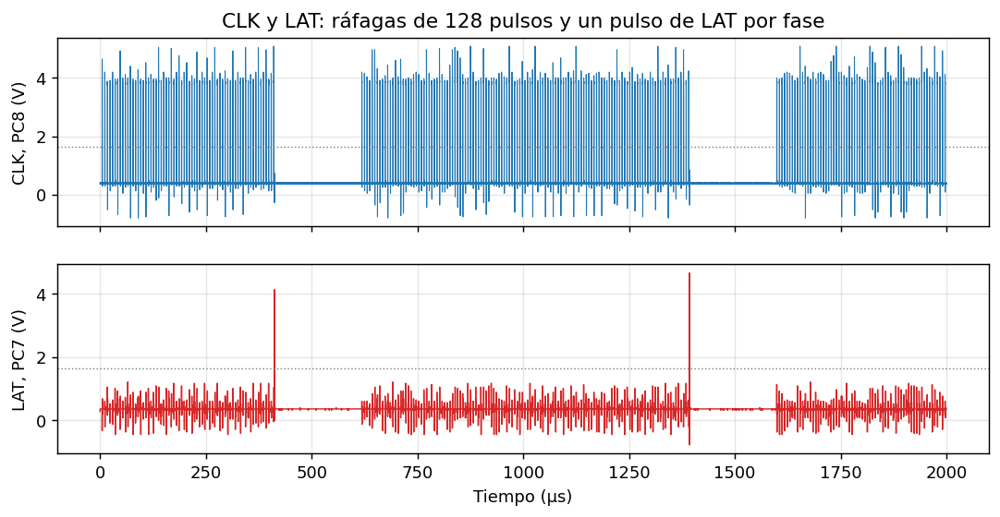
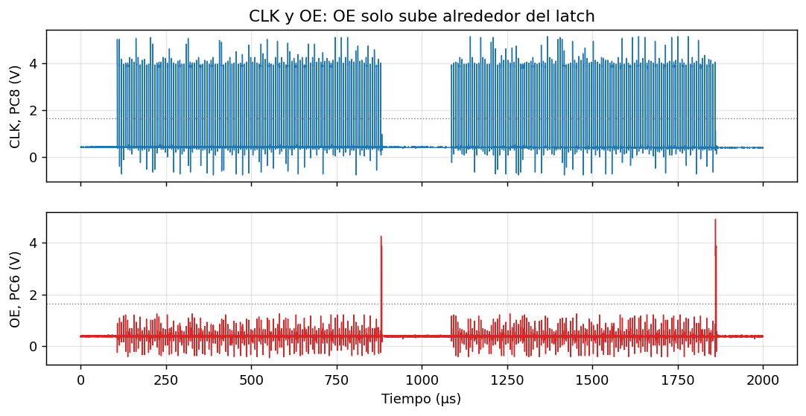
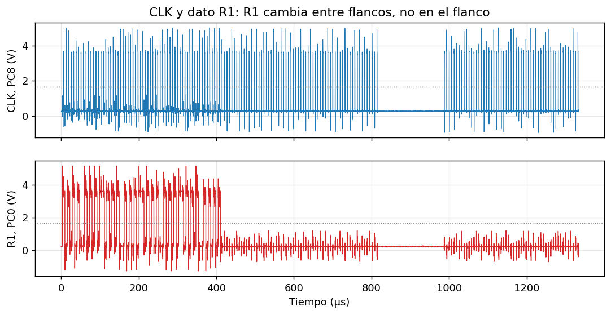
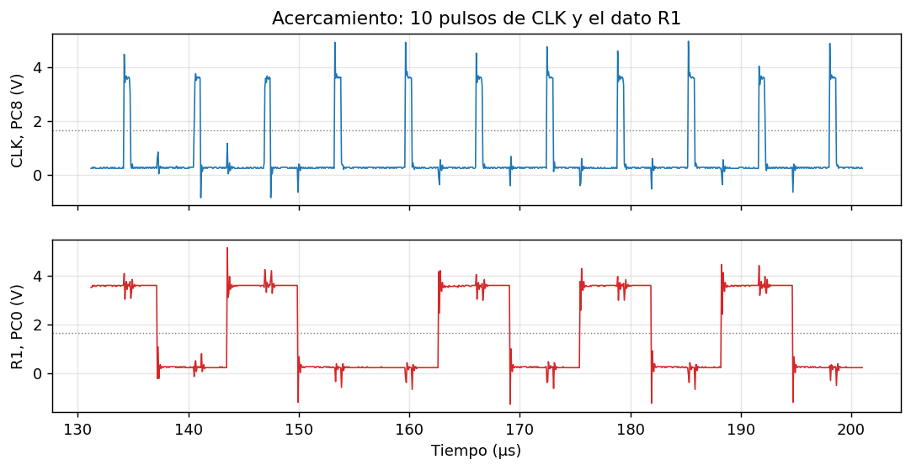
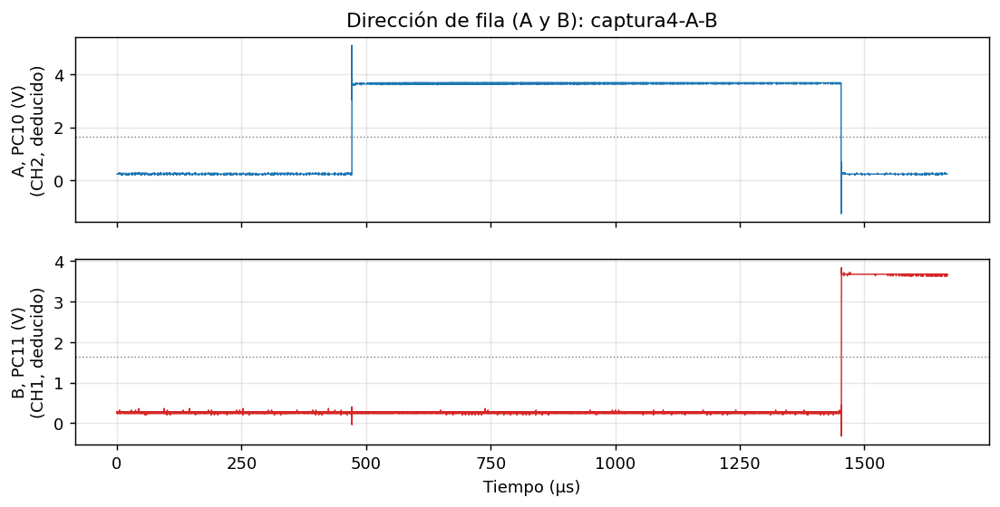
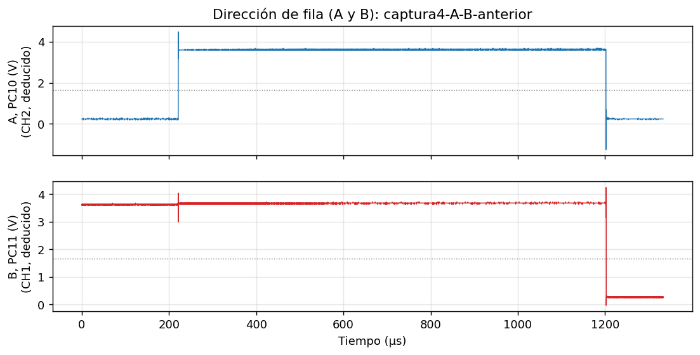
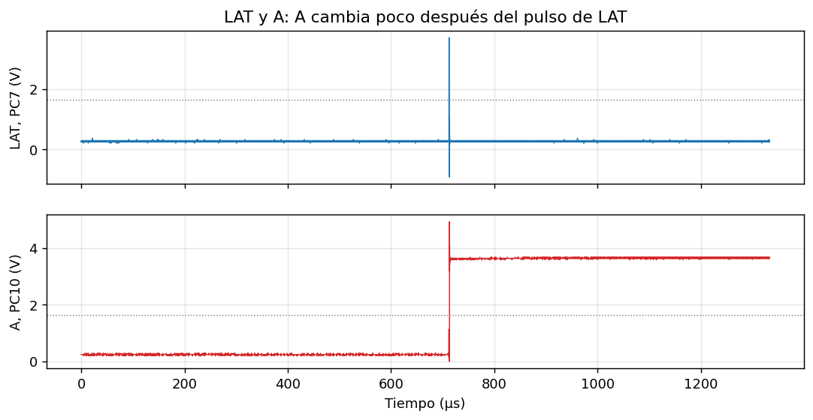
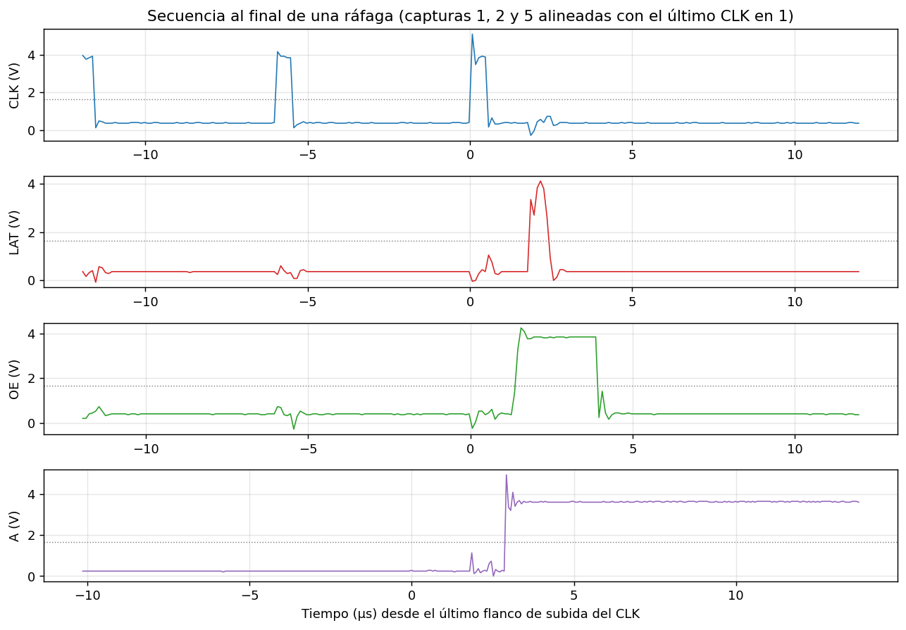
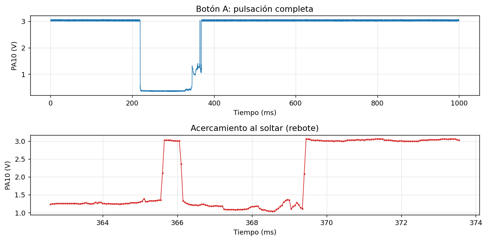

# Mediciones con osciloscopio

Mediciones del 2026-11-21 con un osciloscopio Hantek 6022BE (2 canales), con el firmware del juego definitivo (dos paneles encadenados).

**Cada medición es una carpeta independiente**, como las de [`pruebas/`](../pruebas/README.md): dentro están el **programa** que la analiza (`analizar.py`), su **CSV**, su **gráfica** (PNG) y un **README** que explica cómo funciona el código y por qué se hace así, línea por línea. El código también trae **comentarios en cada línea**, para entenderlo sin abrir el README. Las herramientas que comparten todos (leer el CSV, detectar flancos, agrupar ráfagas, guardar la gráfica) están en [`comun/`](comun/README.md).

## Cómo ejecutarlos

Solo necesitan `python3` con `numpy` y `matplotlib`. Se pueden ejecutar **desde cualquier carpeta**:

```bash
python3 analizar_todo.py                       # los siete, en orden
python3 01_captura1_clk_lat/analizar.py        # uno solo
```

Cada programa imprime los valores medidos y guarda su gráfica **en su propia carpeta**. Los flancos se detectan con un umbral de 1,65 V (mitad de 3,3 V).

## Qué hay en cada carpeta

| Carpeta | Señales | Qué mide | CSV |
|---|---|---|---|
| [`01_captura1_clk_lat`](01_captura1_clk_lat/README.md) | CLK (PC8) y LAT (PC7) | Pulsos por ráfaga (128), periodo y ancho de CLK, periodo de LAT | `captura1-CLK-LAT.csv` |
| [`02_captura2_clk_oe`](02_captura2_clk_oe/README.md) | CLK (PC8) y OE (PC6) | Cuándo sube y baja OE; porcentaje del tiempo con el panel apagado | `captura2-CLK-OE.csv` |
| [`03_captura3_clk_r1`](03_captura3_clk_r1/README.md) | CLK (PC8) y R1 (PC0) | Los 128 bits de R1 y cuánto después del flanco cambia el dato | `captura3-CLK-R1.csv` |
| [`04_captura4_direccion_fila`](04_captura4_direccion_fila/README.md) | A (PC10) y B (PC11) | La cuenta de fases 0, 1, 2, 3 y su duración | `captura4-A-B.csv` y `captura4-A-B-anterior.csv` |
| [`05_captura5_lat_a`](05_captura5_lat_a/README.md) | LAT (PC7) y A (PC10) | Cuánto después de LAT cambia A | `captura5-LAT-A.csv` |
| [`06_captura6_boton`](06_captura6_boton/README.md) | Botón A (PA10) | Duración de la pulsación y rebote al soltar | `captura6-boton-presionar-soltar.csv` |
| [`07_secuencia_de_una_fase`](07_secuencia_de_una_fase/README.md) | CLK, LAT, OE y A | Gráfica con la secuencia completa de una fase (junta las capturas 1, 2 y 5) | las de las capturas 1, 2 y 5 |
| [`comun`](comun/README.md) | (no se ejecuta) | Herramientas que usan todos: leer el CSV, detectar flancos, agrupar ráfagas, guardar gráficas | |

`analizar_todo.py` solo llama a los siete análisis en ese orden. Para estudiarlos: primero [`comun`](comun/README.md) (lo usan todos), y luego `01` → `07`, porque cada uno añade una idea (ráfagas, OE, dato estable, fases, retardos, rebote, alinear señales).

Los resultados de cada medición están explicados abajo.

## 1. CLK y LAT
CSV (en la carpeta de la captura): `captura1-CLK-LAT.csv` (CH1 = CLK en PC8, CH2 = LAT en PC7; ventana de 2 ms).



- Cada fase envía una ráfaga de **128 pulsos** de CLK (dos paneles = 128 bits).
- Periodo entre pulsos: **6,1 µs** (unos 164 kHz). Ancho del pulso: 0,5 a 0,6 µs.
- La ráfaga dura **772 µs**; la pausa hasta la siguiente es de **208 µs**.
- LAT da un pulso de ~0,5 µs por fase, cada **980,3 µs** (el diseño es 1000 µs; el reloj interno corre ~2 % rápido).
- La ráfaga ocupa ~79 % del tiempo de cada fase.

## 2. CLK y OE
CSV (en la carpeta de la captura): `captura2-CLK-OE.csv` (CH1 = CLK en PC8, CH2 = OE en PC6).



- OE casi siempre está en bajo (panel encendido). Solo sube **2,5 µs** por fase, alrededor del latch.
- OE sube 1,3 µs después del último CLK y baja a los 3,9 µs. El panel queda encendido el 99,7 % del tiempo.

## 3. CLK y R1
CSV (en la carpeta de la captura): `captura3-CLK-R1.csv` (CH1 = CLK en PC8, CH2 = R1 en PC0).




- En la ráfaga de 128 pulsos, R1 está en alto en 32 pulsos.
- R1 cambia unos **3 µs después** del flanco de subida del CLK, así que el dato es estable cuando el panel lo lee (en los 128 pulsos vale lo mismo antes y después del flanco).
- Patrón de bits: `1010101001010101` repetido 4 veces y luego 64 ceros. Se interpreta como panel 2 con rojo y panel 1 sin rojo en esa fase (no verificado).
- Con más bits en 1 el periodo sube a 6,3 µs (no se verificó la causa).

## 4. Dirección de fila (A y B)
CSV (en la carpeta de la captura): `captura4-A-B.csv` (fases 0, 1, 2) y `captura4-A-B-anterior.csv` (fases 2, 3, 0).




- A (PC10) es el bit 0 de la fase y B (PC11) es el bit 1: A cambia en cada fase y B cada dos.
- Cada fase dura **0,98 ms**.
- Cuando cambian los dos, B cambia 0,6 µs después de A y hay un estado intermedio de 0,6 µs. Pasa con OE en alto, así que no se ve en el panel.
- **Asignación de sondas (deducida, no verificada):** al medir se anotó CH1 = A y CH2 = B, pero los datos solo cuadran con el código si CH2 estaba en PC10 (A) y CH1 en PC11 (B). Con esa asignación las fases salen 0, 1, 2 y 2, 3, 0, como las cuenta el programa.

## 5. LAT y A
CSV (en la carpeta de la captura): `captura5-LAT-A.csv` (CH1 = LAT en PC7, CH2 = A en PC10).



- A cambia **1,06 µs** después de que LAT sube (0,5 µs después de que baja), una escritura de GPIO después.

## 6. Secuencia completa de una fase
Resume las capturas 1, 2, 4 y 5, alineadas con el último pulso de CLK.



| Instante | Evento |
|---|---|
| 0 | último pulso de CLK |
| +1,3 µs | OE sube (panel apagado) |
| +1,8 µs | LAT sube (dura 0,5 µs) |
| +2,9 µs | cambia A |
| +3,5 µs | cambia B (si la fase cambia los dos) |
| +3,9 µs | OE baja (panel encendido) |
| +208 µs | empieza la ráfaga de la fase siguiente |

El orden coincide con `dibujar_fase` en `juego/src/panel.c`: desplaza los 128 bits, apaga OE, sube y baja LAT, escribe A, escribe B y enciende OE.

## 7. Botón A (PA10)
CSV (en la carpeta de la captura): `captura6-boton-presionar-soltar.csv` (CH1 = PA10; 1 s de ventana, una pulsación).



- En reposo está en alto (~3,0 V). Al presionar baja a ~0,4 V en un solo flanco limpio.
- Estuvo presionado 146 ms.
- **Rebote al soltar: 3,8 ms** (sube, vuelve a bajar y sube definitivamente).

## Corriente de la alimentación
Ver [`08_alimentacion/README.md`](08_alimentacion/README.md).

## Pendiente
- Los niveles altos salen en 3,6 a 3,9 V, con picos de 5,1 V y mínimos de −1,25 V. Una salida de la Nucleo debería dar 3,3 V. Causa sin verificar (cables largos o pinza de tierra larga); no afecta los tiempos.
- Repetir una captura del CLK con la pinza de tierra corta.
- Medir el rebote del botón varias veces (hay una sola pulsación).
- Capturar el ciclo completo de A y B en una sola toma.
- Confirmar qué sonda iba en PC10 y cuál en PC11.
